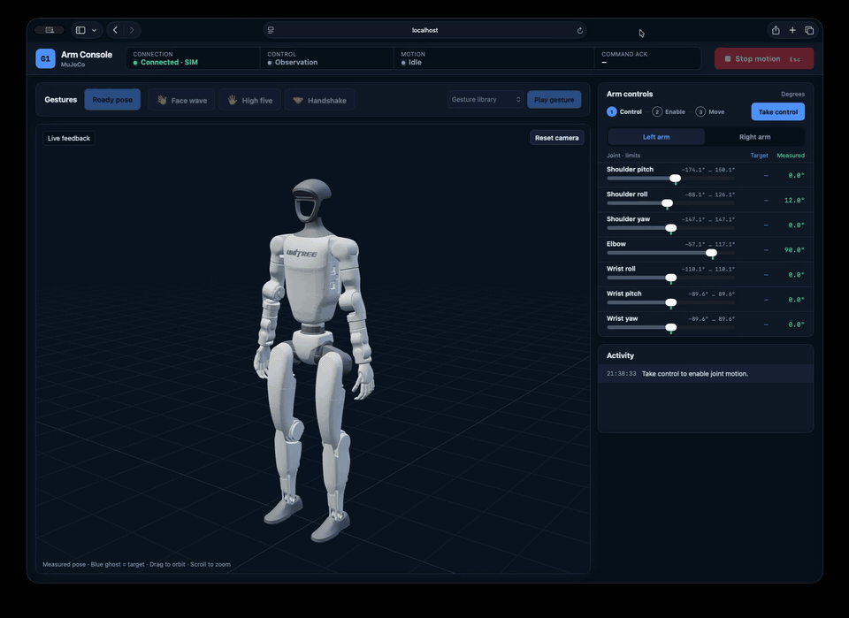
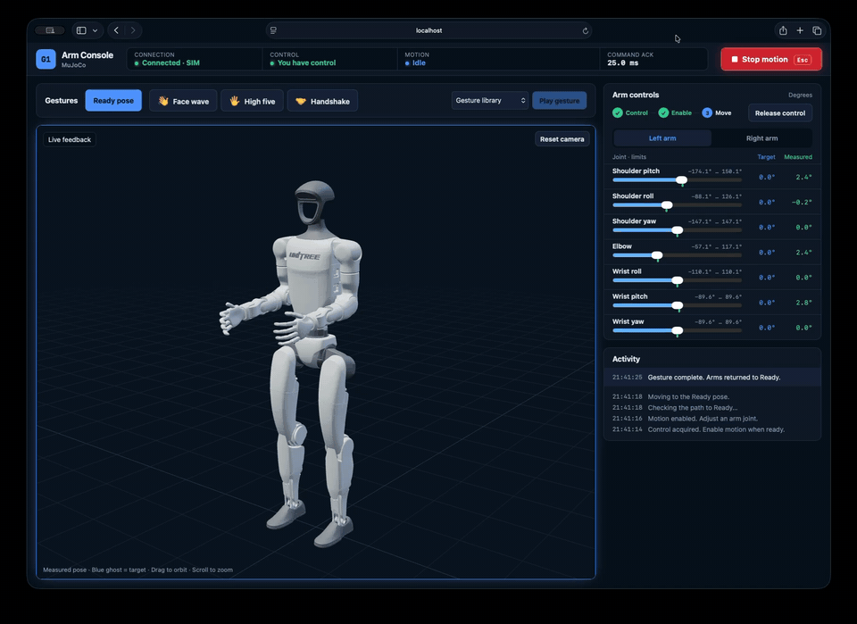
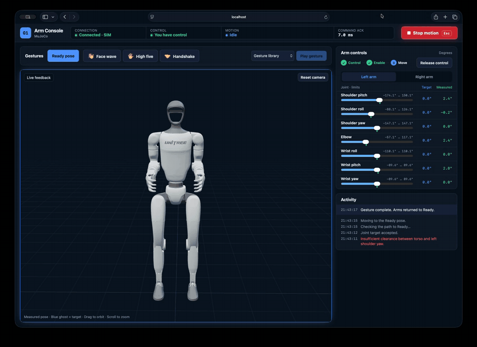

# Unitree G1 Web App

Use the web app to try arm motions, gestures, and locomotion for a 29-DoF Unitree G1. You can set the target angle of each of its 14 arm joints, play or record gestures, and switch to walking in a live 3D view.

Simulation mode uses the Unitree Python SDK to exchange commands and joint feedback with MuJoCo over DDS. Mock mode uses an in-process Python mock. Hardware mode displays measured joint positions from a physical G1 over DDS.

## Requirements

- Docker Desktop on macOS or Docker Engine on Linux, with the Docker Compose v2 plugin.
- A modern browser. WebGL enables the interactive 3D view. The app falls back to a simplified pose preview when WebGL is unavailable.
- `make` is optional. It provides shorter commands and picks the macOS Compose file automatically. [Run with Docker Compose](docs/docker-compose.md)
- Internet access for the initial build, which downloads the base images, dependencies, and robot model.

The app was developed on Apple Silicon macOS and tested on x86-64 Ubuntu Linux on a machine with an NVIDIA GPU. The standard setup needs no GPU passthrough. MuJoCo physics runs on the CPU, and the 3D view runs in the browser, so a laptop with integrated graphics can use the web app. The optional Linux desktop viewer uses Mesa software rendering.

## Build

Start Docker and run the commands from the repository root. The backend runs in Docker. The simulator image includes Python, FastAPI, MuJoCo, the Unitree Python SDK, Cyclone DDS, and the G1 model. Both images include the assets for the browser view.

```bash
make build
```

## Run

### Simulation mode

Simulation mode starts FastAPI and a MuJoCo subprocess in the same container. The simulation starts in supported Arms mode and can switch to free-standing Locomotion. Both modes exchange commands and measurements with the backend via the Unitree Python SDK.

```bash
make up web-sim
```

Open the web app in your browser.

```bash
http://127.0.0.1:8001
```

#### Walk the G1

1. Click **Take control**, select **Locomotion**, and wait for the G1 to stand under the walking policy.
2. Click **Enable motion**. Hold **W** or **S** to walk forward or backward, **A** or **D** to step sideways, and **Q** or **E** to turn. The on-screen buttons work the same way. Release the input to stop walking and balance in place.
3. Select **Arms** to stop, restore pelvis support at the current location and heading, and return to the arm controls. Click **Enable motion** to use the sliders or gestures.

**Stop motion** or **Esc** disables drive input. Use **Reset Stop** before enabling it again. If the robot falls, **Reset simulation** returns it to the starting position in Arms mode. Clear Stop before enabling the arms. The policy is trained for flat ground.

#### Optional MuJoCo desktop viewer

The simulation runs with the web app by default. On macOS or Linux, set `G1_SIM_VIEWER=1` to also start the MuJoCo desktop viewer.

```bash
G1_SIM_VIEWER=1 make up web-sim
```

On macOS, open the noVNC viewer in your browser and click **Connect**.

```bash
http://127.0.0.1:6080/vnc.html
```

On Linux, the viewer opens a local X11 window. It needs `DISPLAY` set and a readable Xauthority file at `$XAUTHORITY` or `~/.Xauthority`.

### Mock mode

Mock mode runs the same web app with simulated joint feedback from an in-process Python model. It runs without MuJoCo or the Unitree SDK.

```bash
make up web-mock
```

Open the web app in your browser.

```bash
http://127.0.0.1:8000
```

Press `Ctrl+C` to stop the foreground run. Use `make down` to remove the app's containers.

### Physical G1 

Hardware mode stays read-only for the entire session. Take control and arm motion are unavailable in `web-hw`.

**Test status.** Hardware mode was not verified with real G1.

On a Linux PC running Docker Engine, connect the G1 over Ethernet. Set the PC's robot-facing interface to an unused address on the robot's subnet, such as `192.168.123.99/24` on the default G1 network. Use the interface name shown by `ip -br addr`. [Unitree networking guide](https://github.com/unitreerobotics/xr_teleoperate/wiki/CycloneDDS-and-UnitreeSDK-%28en%29#42-unitree-robot-development)

```bash
G1_DDS_INTERFACE=enp2s0 make up web-hw
```

Open the web app on the Linux PC.

```bash
http://127.0.0.1:8002
```

**Connected · HARDWARE** indicates fresh DDS feedback. The 3D model and joint readouts follow the physical robot. Hardware mode uses DDS domain `0` by default. Set `G1_DDS_DOMAIN` if your G1 is configured for another domain.

## Webapp Examples 

All six recordings use simulation mode.

### 1. Take control and move to Ready

Click **Take control**, then **Enable motion**, then **Ready pose** to move both arms into position.



### 2. Identify joints with the sliders

Hover over a slider row to highlight the corresponding link in red. The **Target** and **Measured** columns show the commanded and actual joint angles in degrees.



### 3. Move a joint

Drag a slider to change the target angle. The blue ghost robot shows the target pose while the solid robot follows the measured pose.


### 4. Check for collisions

Before accepting a new target, the backend samples the proposed motion in MuJoCo to check clearance between modeled links. If the move fails that check, the app keeps the last accepted target, highlights the affected links in red, and reports **Insufficient clearance** in **Activity**.



### 5. Play a gesture

Select a gesture under **Recorded** and click **Play gesture**. The app checks the planned motion, plays the sequence, and returns the arms to Ready.


### 6. Park the arms and release control

With motion enabled and the arms settled, click **Release control**. The app moves the arms to the parked pose and returns to **Observation**.


## Record a gesture

In simulation or mock mode, take control, enable motion, and click **Record gesture**. Move the arms with the joint sliders, wait for them to settle, then click **Capture pose**. Repeat for each pose, enter a name, and click **Save gesture**.

The app saves one JSON file in `recorded_gestures/` and selects the gesture under **Recorded** in the library. Click **Play gesture** to replay it through the existing trajectory planner. The files load again when you reopen the app. Each pose stores the 14 measured arm angles in radians, in the order defined by [JOINT_NAMES](g1_control/joints.py).

## Run the SDK examples

Keep `web-sim` running in **Arms** mode and release browser control so the example has the arm command topic to itself. Open a shell in the simulator container from a second terminal.

```bash
make shell
```

Run one example at a time and watch the measured motion in the web app or the optional MuJoCo viewer.

```bash
python sdk_example.py
python gesture_exec_example.py recorded-handshake
```

- `sdk_example.py` uses the Unitree Python SDK directly to read joint feedback and publish arm commands. It bends the left elbow, then raises the arm and waves. 
- `gesture_exec_example.py` reuses the web app's gesture library, trajectory planner, MuJoCo clearance checks, and DDS adapter built on the Unitree Python SDK. It calls the selected gesture from the terminal and streams the planned motion to MuJoCo, finishing at the parked pose. It defaults to **Face wave** when the recording is available. Run `python gesture_exec_example.py --help` to see the available IDs.

Use `Ctrl+C` in the terminal to interrupt an SDK example. **Stop motion** in the web app applies to motion issued by the web app.

## Technical architecture

### Browser, backend, and simulator

The browser uses HTML, CSS, plain JavaScript, and Three.js. FastAPI serves the UI and handles commands, acknowledgments, and live feedback over a WebSocket. FastAPI and the simulation communicate over Cyclone DDS through the Unitree Python SDK.

- **Arms.** The SDK publishes setpoints on `rt/arm_sdk`. The simulator maintains pelvis support and returns joint measurements on `rt/lowstate`.
- **Locomotion.** The backend calls the SDK's `LocoClient.SetVelocity` against the simulated `sport` service. Unitree's pretrained 29-DoF velocity policy reads `rt/lowstate` and publishes whole-body motor targets through the SDK on `rt/lowcmd`. The runner releases pelvis support and applies only policy targets while walking. The simulator publishes measured base pose on `rt/sportmodestate` for the browser view.
- **Mode handoff.** The simulator's `g1_sim` SDK RPC handles switching and fall recovery. The simulator controls which command stream can move the robot. Browser controls wait for the simulator to report that the handoff is complete.

The CPU policy runs at 50 Hz with ONNX Runtime. The Docker build fetches and verifies a pinned Unitree MJLab export and its deployment configuration. [Policy and deployment files](https://github.com/unitreerobotics/unitree_rl_mjlab/tree/1425b15f73bd4095f0df53709d7c389c3eb9e790/deploy/robots/g1/config/policy/velocity/v0)

### Local access and motion safeguards

- **Local access.** Docker publishes the app and optional macOS viewer to loopback. The control WebSocket checks the request host and origin, and DDS runs on the container's loopback interface.
- **Control ownership.** The backend grants control to one browser session at a time. The operator explicitly enables motion while feedback is fresh and the arms are stationary. Heartbeats renew the control lease. A disconnect or expired lease cancels motion and releases control.
- **Command execution.** One backend control loop sends setpoints at up to 50 Hz. It enforces joint, speed, and acceleration limits. Simulation mode uses MuJoCo clearance checks when planning and during motion. New slider and gesture requests are blocked while a gesture is being planned or played.
- **Stop and recovery.** **Stop motion** or **Esc** cancels the move and latches Stop. In Arms mode the controller decelerates and releases arm authority. In Locomotion it sends zero velocity and leaves the policy balancing. Drive commands expire after 250 ms, so closing or losing focus on the browser also stops walking. **Reset Stop** and **Enable motion** resume control.

The supported-base simulation verifies arm motion and feedback. The walking policy and mode handoff run in simulation. Physical G1 mode is observation-only.

### Command responsiveness

The browser sends the first slider change immediately after idle and coalesces follow-up changes during a drag. These results come from 30 measured slider clicks in MuJoCo running in Docker on Apple Silicon.

| Interval | Median | p95 |
|---|---:|---:|
| Browser click to command acknowledgment | 51.1 ms | 53.4 ms |
| Server receipt to the first SDK write with a changed setpoint | 9.6 ms | 20.2 ms |
| Server receipt to the first motion detected in DDS feedback | 118.0 ms | 130.4 ms |

The benchmark alternates the left-elbow target between 6° and 18° and skips the first five clicks as warm-up. It detects motion when valid DDS feedback shows a change of at least 0.01 rad in the direction of the target. 

#### Reproduce the measurement

From the repository root, start the simulator with latency tracing enabled. Leave it running in the first terminal and keep the web app in **Observation** mode so the benchmark can take control.

```bash
G1_MEASURE_LATENCY=1 G1_SIM_VIEWER=0 make up web-sim
```

From the repository root in a second terminal, build and run the benchmark.

```bash
docker build -t g1-web-verification ./verification
mkdir -p benchmark-results
sim_container=$(docker ps -q \
  --filter "label=com.docker.compose.project.working_dir=$PWD" \
  --filter "label=com.docker.compose.service=web-sim")
docker run --rm --network "container:$sim_container" \
  --volume "$PWD/benchmark-results:/out" \
  g1-web-verification benchmark
```

The runner prints the median and p95 in the terminal and writes the raw samples to `benchmark-results/latency.csv`.

To verify walking and the Arms handoff in Chromium, start a fresh `web-sim` service, build the same verification image, then run its `locomotion` scenario in the simulator's network namespace.

```bash
docker run --rm --network "container:$sim_container" g1-web-verification locomotion
```

### Reference documents

- The custom runner's `rt/arm_sdk` interface, factory gesture IDs, and which G1 features the simulator supports. [G1 SDK and MuJoCo simulation](docs/g1-mujoco-runner-comparison.md)
- The SDK2 comparison covers differences between the Python and C++ interfaces for arm actions, locomotion, hands, and other G1 features. [SDK2 comparison](docs/unitree_g1_sdk2_comparison.md)

